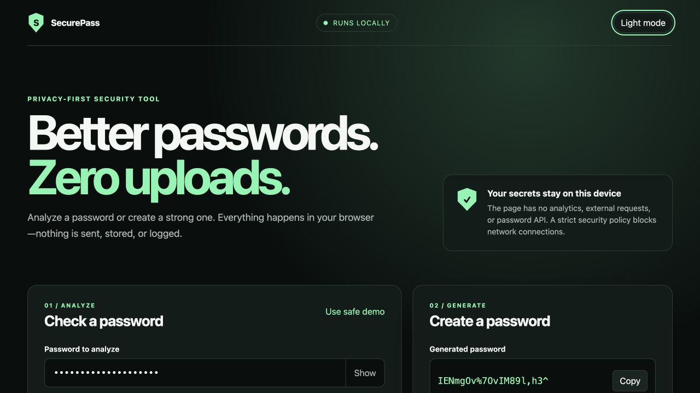

# SecurePass

SecurePass is a privacy-first, local password strength analyzer and secure
password generator. The interface is served by a small Flask application, but
all password analysis and generation happens in the browser. Password values
are never sent to Flask, written to storage, logged, or shared with an API.



## Why this project exists

Many password checkers ask users to trust a remote service with sensitive
input. SecurePass demonstrates a simpler defensive design: keep secret values
on the user's device, remove unnecessary network access, use cryptographic
randomness, and explain the limitations instead of presenting a score as proof
of safety.

## Features

- Pattern-aware strength analysis using the established zxcvbn estimator
- Detection of common passwords, names, dates, repetition, and sequences
- Approximate search-space and offline-guess-time explanation
- Secure password generation using Web Crypto
- Bias-free random character selection through rejection sampling
- Guaranteed inclusion of each selected character category
- No analytics, cookies, external fonts, password API, or secret storage
- Strict Content Security Policy and no-store response headers
- Keyboard-friendly, responsive interface with reduced-motion support
- Accessible light and dark themes
- Python route/header tests and JavaScript analysis/generator tests
- GitHub Actions workflow for Python and JavaScript tests

## Technology stack

- Python 3 and Flask for local static delivery and security headers
- Vanilla HTML, CSS, and JavaScript for the interface
- zxcvbn 4.4.2, bundled locally, for pattern-aware estimation
- Web Crypto for password generation
- pytest and Node's built-in test runner

## Run locally

Requirements: Python 3.10+ and a modern browser.

```bash
python3 -m venv .venv
source .venv/bin/activate
python -m pip install -r requirements.txt
python app.py
```

Open `http://127.0.0.1:5000`. Use only synthetic examples during demos. The
“Use safe demo” button loads `Demo!River-Quartz-47`, which is not a real secret.

## Run the tests

```bash
python -m pip install -r requirements-dev.txt
python -m pytest -q
npm test
```

The JavaScript test command uses Node's built-in test runner, so it does not
download npm packages.

## Architecture

```text
Browser
  ├─ zxcvbn.js    estimates pattern-aware guess resistance locally
  ├─ security.js  adapts estimates and generates locally
  ├─ app.js       updates the interface
  └─ no outbound connections allowed
          ↑
          │ static GET requests only
          ↓
Flask
  ├─ GET /        serves the interface
  └─ GET /health  reports service health
```

The project intentionally has no `POST` route. The automated test suite checks
that a password cannot be posted to the server and that privacy/security
headers are present.

For a file-by-file explanation and honest demo script, read
[PROJECT_WALKTHROUGH.md](PROJECT_WALKTHROUGH.md).

## Demo examples

These values are synthetic and must not be used as real passwords:

| Example | Expected lesson |
|---|---|
| `Password1234!` | Common patterns reduce practical strength |
| `aaaaaaaaaaaa` | Length alone cannot rescue obvious repetition |
| `Demo!River-Quartz-47` | A longer mixed example scores better, but is public and unsafe for real use |

## Limitations

The score is a teaching aid, not a security guarantee. zxcvbn improves practical
pattern detection but cannot know every targeted guess, leaked credential, or
attacker assumption. It is not a replacement for a password manager,
multi-factor authentication, or an organization-specific policy. The displayed
offline-fast-hash estimate assumes 10 billion guesses per second; actual
conditions vary widely. SecurePass does not query breach databases in order to
preserve its offline privacy model. See [SECURITY.md](SECURITY.md) for the full
threat model and [THIRD_PARTY_NOTICES.md](THIRD_PARTY_NOTICES.md) for the bundled
estimator notice.

## Verified test result

The current release passes **10 automated tests**: four Flask privacy/route
tests and six JavaScript estimator/generator tests. GitHub Actions repeats both
suites on pushes and pull requests.

## Future improvements

- Optional, privacy-preserving compromised-password checks using a documented
  range-query protocol, disabled by default
- Browser automation for keyboard accessibility and theme contrast
- User-selectable, clearly explained attacker-rate scenarios

## AI-assisted authorship disclosure

This project was developed with assistance from OpenAI's Codex. Codex helped
generate the initial application code, tests, interface, and documentation.
The repository owner is responsible for reviewing the code, running and
understanding the tests, making any later changes, and accurately describing
their own contribution. This repository should not be presented as work coded
independently without AI assistance.

## Responsible use

SecurePass is a defensive educational project. Never paste a real password
into screenshots, bug reports, issues, commits, or public demonstrations.

## License

[MIT](LICENSE)
